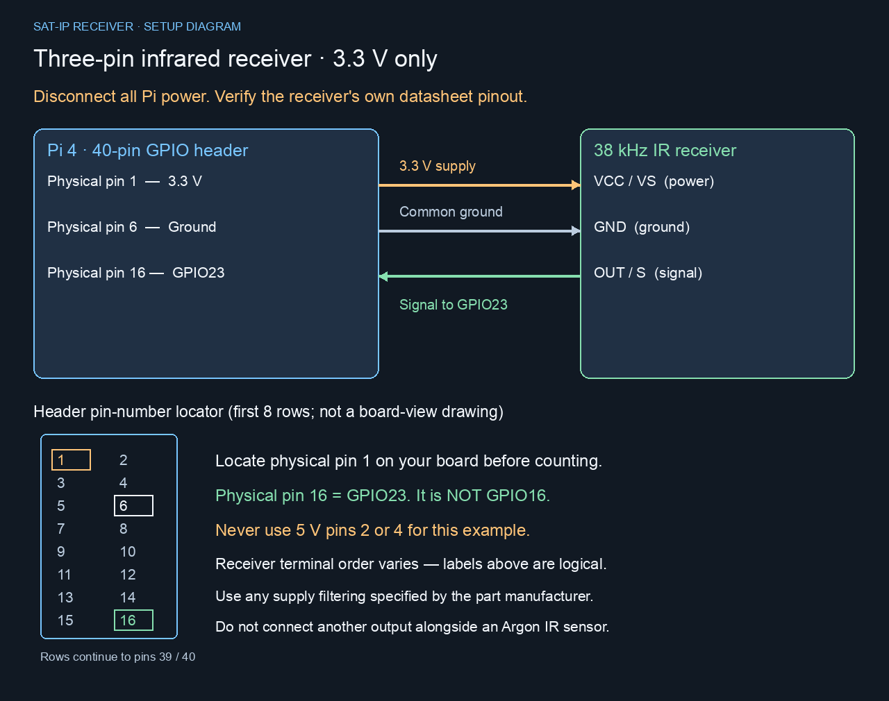

# Infrared receiver and Apple Remote

**Audience: users.**

[User manual](user-manual.md#using-an-infrared-remote) · [Controls](usage.md#television-controls)

A Raspberry Pi 4 needs an external IR receiver to receive an infrared remote's
signals. The appliance image enables a GPIO receiver and provides a keymap for
the silver Apple Remote A1294. A USB keyboard can be used alongside it.

## Use the Argon ONE V2 case

The reference hardware is the **Argon ONE V2 for Raspberry Pi 4**, including its
GPIO23 IR receiver. Assemble the case/daughterboard using the case instructions,
with power disconnected. Check the GPIO connector seating and keep the IR window
clear. The appliance image supplies the IR driver and keymap; no additional
Argon IR application is needed for television controls. This does not imply
support for every Argon case revision or its own remote/power-button features.
See [reference hardware](reference-setup.md) and the [Argon40 website](https://argon40.com/).

Do not wire a separate receiver output to GPIO23 while the case's receiver is
connected. Do not join two digital outputs together.

## Wire a separate three-pin receiver

Choose a **38 kHz demodulating receiver** rated for **3.3 V** operation and a
3.3 V-compatible logic output. Its pins may be named VCC/VS, GND and OUT/S.
A phototransistor or IR transmit LED is not the same component. Pin order differs
between bare sensors and modules: use the specific part's datasheet.

| Receiver terminal | Pi signal | Physical header pin |
|---|---|---|
| VCC / VS | 3.3 V | 1 |
| GND | Ground | 6 |
| OUT / S | GPIO23 | 16 |

1. Shut down and disconnect the Pi's power and any accessory that could feed power.
2. Locate physical pin 1 from the board marking. Physical pin numbers describe
   header positions; **GPIO23 is physical pin 16, not GPIO16**. On a bare Pi 4,
   component-side up with USB/Ethernet on the right, the header is along the upper
   edge. Pin 1 is at the left end of the inner row nearest the board centre; odd
   pins run along the inner row and even pins along the outer row. For an Argon
   breakout, follow its own pin markings rather than assuming the same orientation.
3. Identify the receiver's terminals using its datasheet. Wire the three signals
   in the table. Use short insulated leads and secure each connector.
4. Include the supply filtering recommended by the part manufacturer. A module
   may already include the required components.
5. Check polarity, shorts and the selected header pins before reconnecting power.
6. Point the Apple Remote at the sensor and test a button as described below.

**Never use 5 V on a GPIO input.** The Pi's GPIO inputs are not 5 V tolerant.
This example powers the receiver from pin 1 (3.3 V), not pins 2 or 4 (5 V).
It does not depict a universal left-to-right pin order or receiver viewing angle.

The image already contains the boot configuration

dtoverlay=gpio-ir,gpio_pin=23,rc-map-name=rc-empty

and loads the Apple keymap automatically. Do not add another overlay or change
GPIO numbers when using the wiring above. GPIO receiver and standard USB keyboard
inputs are enabled together, including hotplug of the keyboard.

## Check the remote

The supported remote is the Apple **A1294**, with a separate Play/Pause button.
Siri/Bluetooth remotes and arbitrary TV/Argon remotes are not supported by this
keymap. Check the battery, aim at the receiving face/window and use short taps.

During first setup, press an arrow or Centre button and look for **Button received**
in the browser. Infrared receiver connected to GPIO means the input device is
present; it does not by itself prove a valid remote signal or matching keymap.
After setup, Centre opens favourites, Up/Down changes channels, Right/Left changes
volume while playing, and Play/Pause controls configured USB time shifting.

If the keyboard works but IR does not, check these in order:

1. Battery and line of sight; avoid covering the sensor inside an opaque case.
2. Receiver voltage, correct part pinout and physical header-pin positions.
3. GPIO connector seating, or the Argon daughterboard seating.
4. The remote model and keymap ID, as described below.

Disconnect power before any wiring correction. Do not reset channels or reflash
the card just to fix an IR problem.

## Learn another Apple Remote ID

The bundled map was captured from remote ID **0xaa**. Another A1294 can have a
different ID. Learning is a one-time advanced operation; it needs SSH and a copy
of the project's source checkout on your computer, but no new image build.
It records button presses, not Wi-Fi or web passwords. Do not learn or probe
input while the normal player is using it.

1. In Settings, set a root password and enable SSH. Connect from your computer
   using the Pi's numeric address and normal SSH host-key verification.
2. From the source checkout on your computer, copy the guided tool:

~~~sh
ssh root@RECEIVER_IP 'umask 077; cat > /root/learn_apple_remote.py' < validation/learn_apple_remote.py
ssh root@RECEIVER_IP
~~~

3. Finish scans, imports and browser Live TV. On the Pi, stop the owned player,
   create a private output directory and run the learner. A cleanup trap restarts
   the player if the learning command fails or you close this shell normally:

~~~sh
export PYTHONPATH=/opt/satip SATIP_RUNTIME_ROOT=/run
python3 -m satip_appliance.supervisor player stop
trap 'python3 -m satip_appliance.supervisor player start' EXIT INT TERM
work=$(mktemp -d /root/ir-learning.XXXXXX)
python3 /root/learn_apple_remote.py --output-dir "$work" --this-remote-only --apply
~~~

4. Tap each requested button once and release it. Wait for **COMPLETE** and the
   reported keymap/result paths. If learning fails, do not replace the saved map;
   inspect the message, correct the problem and retry. Do not use --all-remote-ids:
   it exceeds the tested Pi's keytable size limit.
5. After successful learning and readback, back up the current persistent map and
   replace it with the **exact reported** generated file. Replace the placeholder
   with that file's path, not a wildcard or an incomplete result:

~~~sh
cp /etc/rc_keymaps/apple-a1294-satip.toml "$work/previous-persistent-map.toml"
cp /root/ir-learning.XXXXXX/apple-remote-TIMESTAMP/apple-a1294-satip.toml /etc/rc_keymaps/apple-a1294-satip.toml
chmod 644 /etc/rc_keymaps/apple-a1294-satip.toml
python3 -m satip_appliance.supervisor player start
trap - EXIT INT TERM
~~~

6. Test controls and reboot once to verify that the saved map loads automatically.
   The map lives in persistent input settings on the appliance. A full configuration
   backup includes it; a channel-only backup does not. Reflashing without restoring
   that configuration returns to the packaged map.

The learner selects only gpio_ir_recv, not HDMI CEC, and checks the kernel
keytable after loading. For tool details, see the [validation tools](../validation/README.md).
Learning changes the local Pi mapping; it does not pair/reconfigure the remote.
