# SAT-IP Receiver — User Manual

**Audience: users.**

Set up your Raspberry Pi 4 receiver yourself, then watch television, arrange channels and change settings from a phone or computer. Routine setup needs no terminal or configuration-file editing.

## Main features

- Live HD/SD television with USB time shifting: pause, resume and go back.
- Web interface for guided setup, channel searches and configuration.
- Live TV streaming to a phone, tablet or computer through the web interface.
- Support for SAT-IP servers and Enigma2 TV boxes.
- YouTube playback from linked phones and tablets.
- Favourite channel lists with your own channel order.
- On-screen programme information and English/German TV menus.
- USB keyboard and Apple infrared remote control.
- HDMI surround sound with stereo fallback.
- Ethernet and Wi-Fi connectivity.
- Channel and configuration backup/restore.
- Receiver status monitoring and automatic playback recovery.

## Contents

- [Main features](#main-features)
- [Before you begin](#before-you-begin)
- [Quick start](#quick-start)
- [First-time setup](#first-time-setup)
- [Watching television](#watching-television)
- [Using an infrared remote](#using-an-infrared-remote)
- [Using the browser interface](#using-the-browser-interface)
- [Managing channels and favourites](#managing-channels-and-favourites)
- [Changing settings](#changing-settings)
- [Backups](#backups)
- [Optional features](#optional-features)
- [Restarting and shutting down](#restarting-and-shutting-down)
- [Troubleshooting](#troubleshooting)
- [Further checks and recovery](#further-checks-and-recovery)

## Before you begin

Illustrations use example names, addresses and readings. Follow the values shown
on your own receiver.

### Choose where your television comes from

The Pi receives television over your home network and sends picture and sound to your TV over HDMI. **It has no satellite or cable tuner of its own.** It needs one of the following sources; you do not need both.

**SAT-IP server:** A network satellite tuner, such as a Telestar Digibit Twin, connected to your satellite dish or distribution system. Choose a free tuner during setup, then scan for channels on Astra 19.2°E.

**Enigma2 receiver:** A compatible TV box, such as a VU+ receiver, with working channels and OpenWebif streaming enabled. Its saved channel groups are called **bouquets**. Choose and import these groups during setup; no satellite scan or tuner-number selection on the Pi is needed.

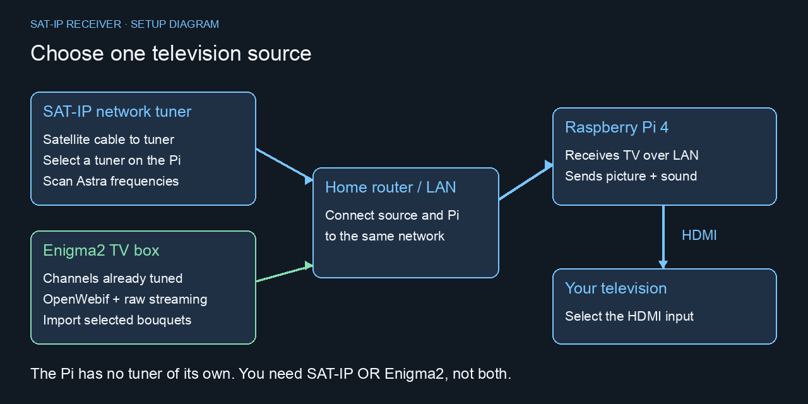

Both sources need free tuner capacity. Keep the source powered and reachable. Enigma2 viewing or recordings can compete for tuners; deep standby usually disables streaming. Importing channels does not change the channel shown on the Enigma2 box.

Both sources support genuinely free-to-air HD/SD channels using H.264 or MPEG-2 and supported German main audio. Encrypted subscription channels, UHD/HEVC, radio and permanent recording are not supported.

> **One viewing activity at a time:** Watching in a browser pauses the Pi's HDMI television. A channel scan or bouquet import also pauses Pi viewing. Stop or finish that activity to return to the TV.

### What you need

- A Raspberry Pi 4, a suitable USB-C power supply, a ventilated case and a microSD card large enough for the appliance image.
- The project's appliance SD-card image, normally **sdcard.img**. It is not a standard Raspberry Pi OS image. If you need to create the image yourself, follow the [Buildroot image guide](../buildroot/README.md).
- A television or AV receiver and a micro-HDMI-to-HDMI cable; an Argon ONE V2 case uses its own exposed HDMI connectors.
- A home router and either Ethernet or a supported Wi-Fi network. Ethernet is recommended for reliable reception.
- Either a working SAT-IP server or a compatible Enigma2 receiver on the same home network.
- A USB keyboard for the easiest first setup, especially when using Wi-Fi. For everyday infrared control, use an Apple Remote A1294 and a connected IR receiver; see [Using an infrared remote](#using-an-infrared-remote). A remote alone cannot enter a first-boot Wi-Fi password. HDMI-CEC TV remotes are not supported.
- A phone, tablet or computer with a web browser on that home network.
- A dedicated USB stick or USB drive if you want to pause and rewind TV with [time shifting](#usb-time-shifting-pause-and-go-back). Prefer USB 3 storage; an SSD is recommended for reliability. Use a drive without files you need, as preparing it may require formatting.

## Quick start

Follow these steps in order. Steps 1–3 are the same for both television sources.

| Step | What you do | Where |
|---|---|---|
| 1 | Flash the appliance image to the microSD card | Your computer, using Raspberry Pi Imager or a similar image writer |
| 2 | Connect the card, TV, power and Ethernet; or attach a keyboard to set up Wi-Fi | The Pi and the TV screen |
| 3 | Scan the TV's QR code with your phone, or open its URL in a browser | Your phone, tablet or computer |
| 4 | SAT-IP: select server/tuner and scan. Enigma2: select receiver/bouquets and import | The browser setup page |
| 5 | Select your favourite channels | The browser setup page |
| 6 | Arrange favourites and save to start TV | The browser setup page |
| 7 | Set the hostname, timezone and other preferences, then make a backup | Settings in the browser |

**Already set up?** Skip flashing and first setup. TV starts automatically after power-on; use the browser's Channels and Settings pages for changes. Your saved configuration survives restarts.

## First-time setup

### 1. Flash the microSD card

1. Download/install **Raspberry Pi Imager** on your computer, or use another raw SD-image writer. The official download is [Raspberry Pi software](https://www.raspberrypi.com/software/).
2. Obtain the appliance **sdcard.img** file. If supplied as **sdcard.img.zip**, extract it first. Check the image checksum against the supplied checksum file; the [image guide](../buildroot/README.md#provision-the-flashed-card) explains release/build verification.
3. Insert the microSD card in your computer's card reader. In Imager, choose **Raspberry Pi 4** if asked for a device.
4. In the operating-system/image choice, select **Use custom** and select **sdcard.img**. Do not choose Raspberry Pi OS.
5. In the storage choice, select the correct microSD card. Check its capacity and name so you do not select a hard drive or another card.
6. Select **Write** (or proceed with **Next** and confirm writing, depending on Imager version). Skip Raspberry Pi OS customisation: configure this appliance's Wi-Fi, hostname and passwords on the receiver instead.
7. Wait for writing and verification to finish. Eject the card safely and remove it from the computer.

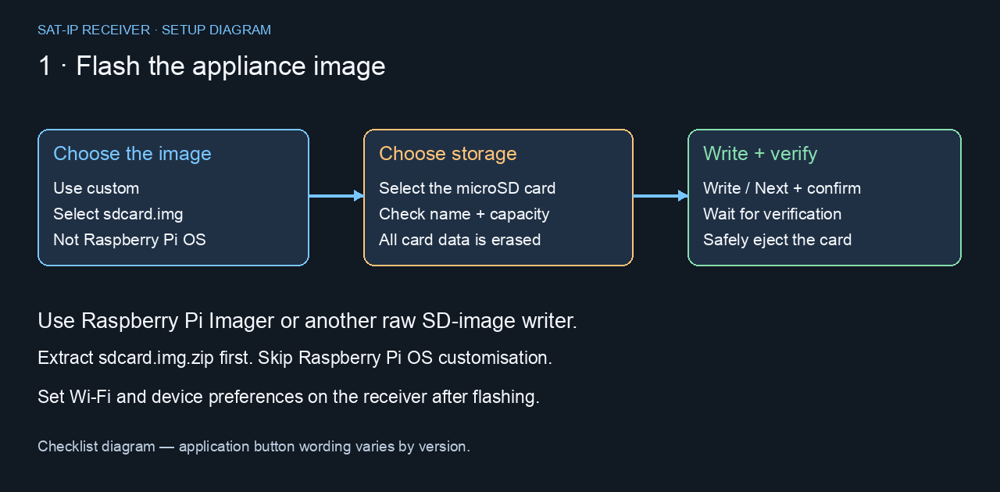

> **Writing the image erases the whole selected card.** Do not reflash a working receiver just to change settings or channels. Back up an existing installation before replacing its image.

### 2. Connect the TV and your home network

With the Pi's power disconnected, insert the flashed card and connect HDMI to the TV. Select that HDMI input on the TV. Connect your fitted IR receiver or USB keyboard before powering on if available.

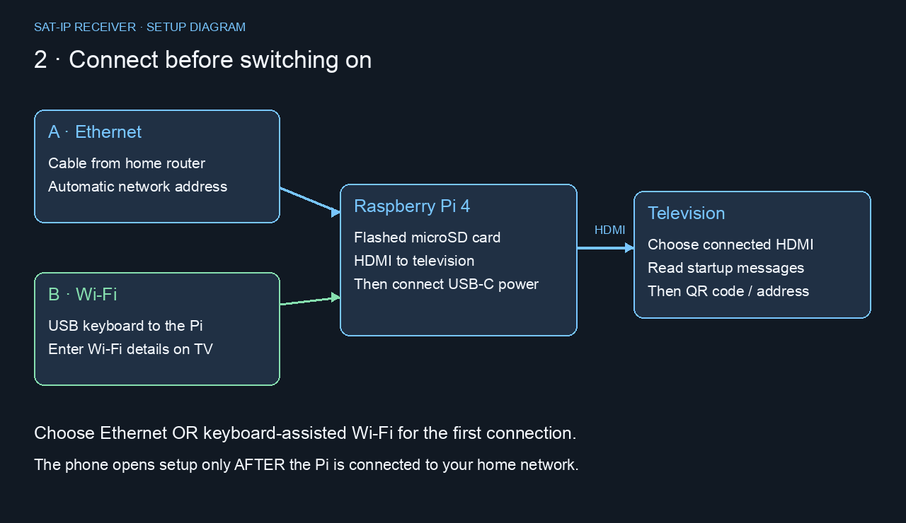

**Option A — Ethernet:** Connect an Ethernet cable from the Pi to your home router, then connect power. The receiver obtains a network address automatically. Wait until the TV shows the setup address and QR code. You do not need to enter a Wi-Fi password.

**Option B — Wi-Fi:** Connect a USB keyboard to the Pi, leave Ethernet disconnected and connect power. On the TV:

1. Use **Up/Down** to select your country. Press **Tab** to select **Deutsch (QWERTZ)** or **US English (QWERTY)** to match the physical keyboard.
2. Press **Enter** to search for Wi-Fi networks.
3. Use **Up/Down** to select your home network, then **Enter**. Press **R** to search again if it is missing.
4. Type the Wi-Fi password. **Backspace** corrects a mistake; **Esc** goes back. Check Caps Lock and keyboard layout. The password characters are hidden.
5. Press **Enter** and wait for the receiver to confirm the connection and display a browser address.

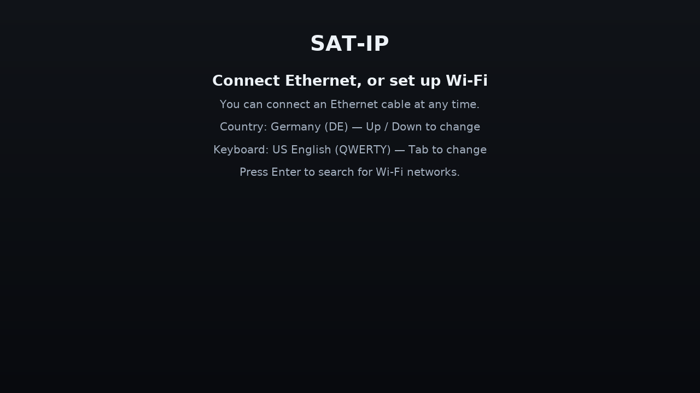

Use a visible WPA/WPA2 Personal network; mixed WPA2/WPA3 works only if it accepts WPA2 passwords. Open, enterprise and WPA3-only networks are not supported. Use Ethernet if your network is incompatible. You can connect an Ethernet cable at any point. Internet access is not needed to verify this home-network connection.

**Continue when:** The TV shows a setup address and QR code. This first-boot Wi-Fi connection is saved automatically; there is no browser Keep settings confirmation at this stage. Wi-Fi country/layout/password are entered on the Pi's USB keyboard, not on the computer used in the next step.

### 3. Open setup on your phone or computer

Connect your phone/computer to the **same home network** as the Pi and the TV source. Do not use a guest network or your phone's mobile-data connection.

- **Phone/tablet:** Open the camera, point it at the QR code shown on the TV and open the suggested link.
- **Computer, or no QR scan:** Type the complete address shown on the TV into the browser's address bar, including **http://** and **:8080**. For example, **http://192.168.1.42:8080/** is an example only; use your Pi's address.

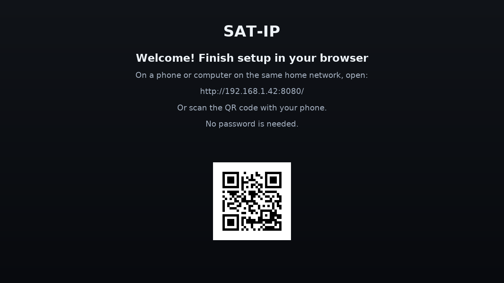

Bookmark the working address. A name such as **http://satip-a1b2c3.local:8080/** may also work; use the numeric address if it does not. If necessary, find the Pi in your router's connected-device list.

**Continue when:** Your browser shows **SAT-IP first setup**. No login is required. If it already shows Status/Channels/Settings, first setup has been completed.

At the top of setup, press an arrow or OK button on the Pi's keyboard/remote and look for **Button received**. Standard USB keyboards and GPIO infrared work together automatically; only an additional USB remote needs **Use this control**. Receiver name and Timezone can be saved here or later in Settings.

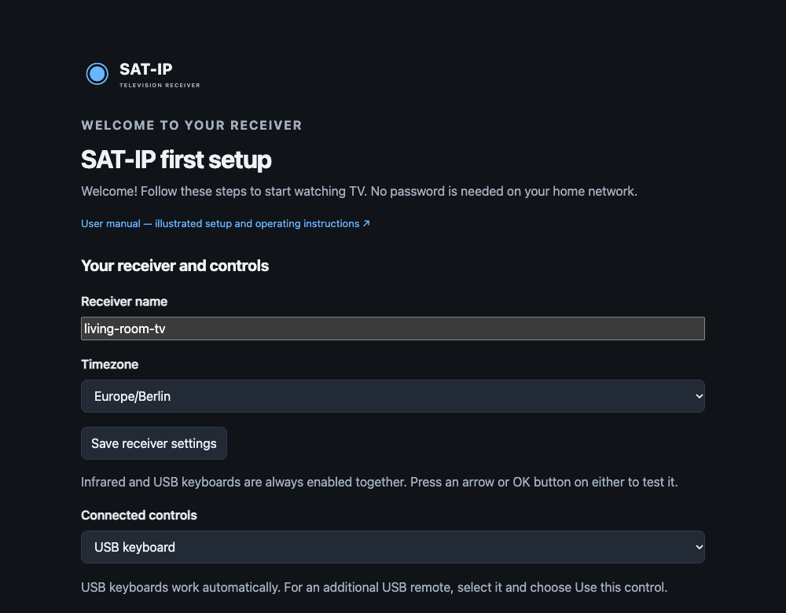

### 4. Choose your source and load channels

In **TV source discovery**, choose **Source type**. Follow **only one** of the two paths below. SAT-IP scanning and Enigma2 bouquet importing lead to the same favourites screens in steps 5–6.

### 4A. SAT-IP — select a tuner and scan

Use this path for a network SAT-IP tuner, not for an ordinary Enigma2 box streaming through OpenWebif.

1. Choose **SAT-IP server** as Source type.
2. In the **SAT-IP server** section, a single discovered server connects automatically. If several are found, select yours in **Server**. Select **Search again** if necessary. Keep the server powered and on the same non-guest home network.
3. If discovery finds none, expand **Add server by description URL** and enter the server's private-LAN SAT-IP XML description URL from its configuration/manual. Supported HTTP ports are 80, 8080 and 38400. This is the server's XML description, not the Pi's setup address.
4. Once it reports ready, select an available **Tuner**. This is a receiving resource in the external server, not a TV channel number. Do not choose a tuner already occupied by another device.
5. Select **Scan**. Wait while the Pi searches the installed Astra 19.2°E frequency list. If you already have a SAT-IP channel backup, select **Restore channel backup instead**, choose its `.tar` file, review the date and channel/favourite counts and confirm. This imports the saved lineup and finishes setup without a full scan; skip steps 5 and 6 below and check picture and sound. Cancel leaves setup ready to scan or choose another backup.

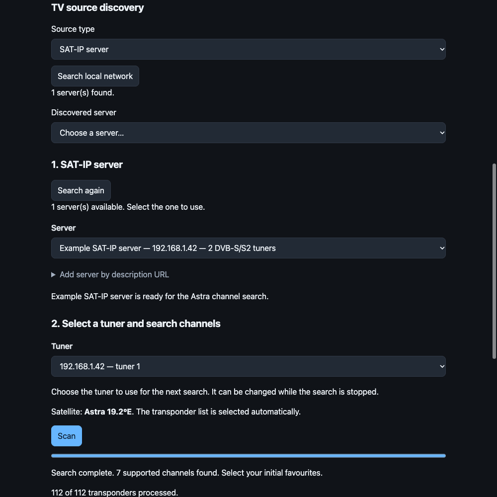

**A full scan can take more than ten minutes.** It starts with common channels, then continues through the frequency list. Progress shows transponders searched and supported channels found. A transponder is a group of channels on one satellite frequency.

**Stop search** keeps channels found so far. If a warning offers **Restore tuner settings**, use that before continuing. If no channels are found, check the satellite signal and selected tuner's availability, then retry. Do not import Enigma2 bouquets for a SAT-IP-only server.

**Continue when:** The scan is finished or stopped, recovery is complete, and channels are listed under Choose your favourites.

### 4B. Enigma2 — select a box and import bouquets

Use this path for a compatible Enigma2 TV box with its channels already tuned. No preliminary SAT-IP scan or tuner-number selection is needed.

1. On the Enigma2 box, verify that its own television channels work. Enable **OpenWebif** and raw streaming in the box's settings/plugins. This Pi integration requires HTTP OpenWebif access without a login on a trusted private network, normally port **80**, and raw streaming, normally port **8001**. It does not use the transcoding port 8002 or HTTPS/authenticated OpenWebif access. Keep authentication on if your network is untrusted; do not use this integration there.
2. On the Pi's setup page, choose **Enigma2 receiver** as Source type. The SAT-IP tuner/scan section disappears.
3. Select **Search local network**, then select your box under **Discovered server**. Alternatively, enter its **Receiver IPv4 address**, **OpenWebif port** and **Raw stream port**. Find its address in the box's network settings or your router. Non-default OpenWebif ports require manual entry.
4. Select **Load TV bouquets**. This lists the groups already saved on the box; it does not scan satellite frequencies or change the box's selected channel.

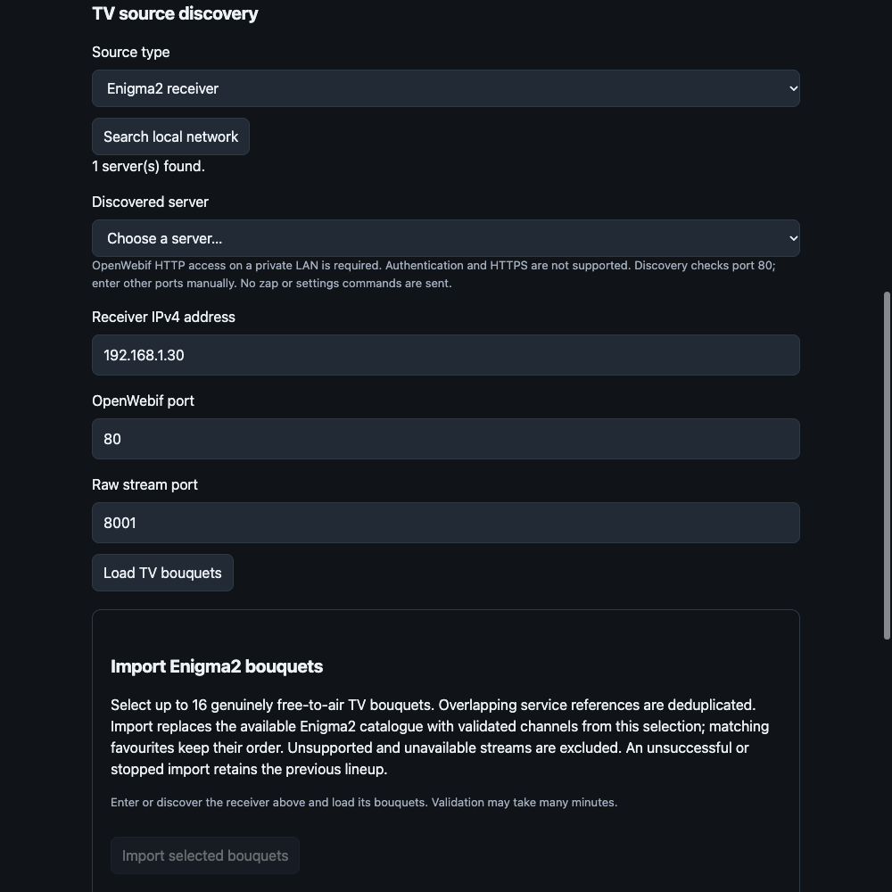

5. Under **Import Enigma2 bouquets**, check the TV bouquets you want, up to 16. Choose groups of genuinely free-to-air channels. Do not select pay-TV groups such as HD+ or Sky. A bouquet is only a channel list; its name does not prove every channel is free-to-air.
6. Select **Import selected bouquets**, confirm, and wait while streams are checked. This can take many minutes and needs free tuner capacity on the box. Unsupported or unavailable channels are omitted; overlapping channel references appear only once.

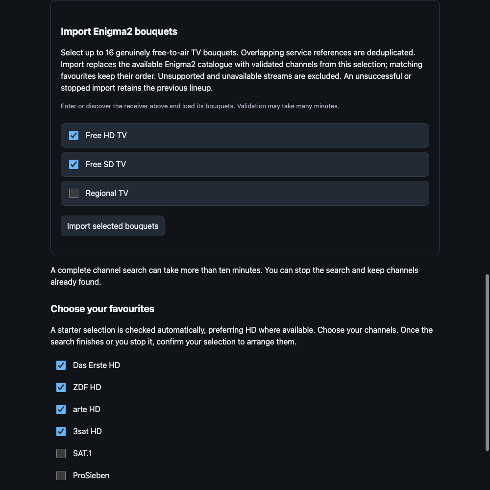

Stopping or failing an import keeps the previous list rather than publishing an incomplete replacement. Use the offered recovery control if necessary. The Pi does not retune or reconfigure the Enigma2 box through remote-control commands, but opening streams uses its tuner capacity.

**Continue when:** Import has completed successfully and the validated channels appear under Choose your favourites. The favourites/order screens are the same as for SAT-IP.

### 5. Select your favourites

**Your favourites** is the list used by the Pi's daily channel buttons and TV menu. You do not need to select every channel found or imported.

1. Under **Choose your favourites**, check the channels you want and uncheck those you do not. A starter selection may already be checked; it prefers HD versions where available.
2. Choose at least one channel.
3. After the scan/import and any recovery finish, select **Confirm favourites**.

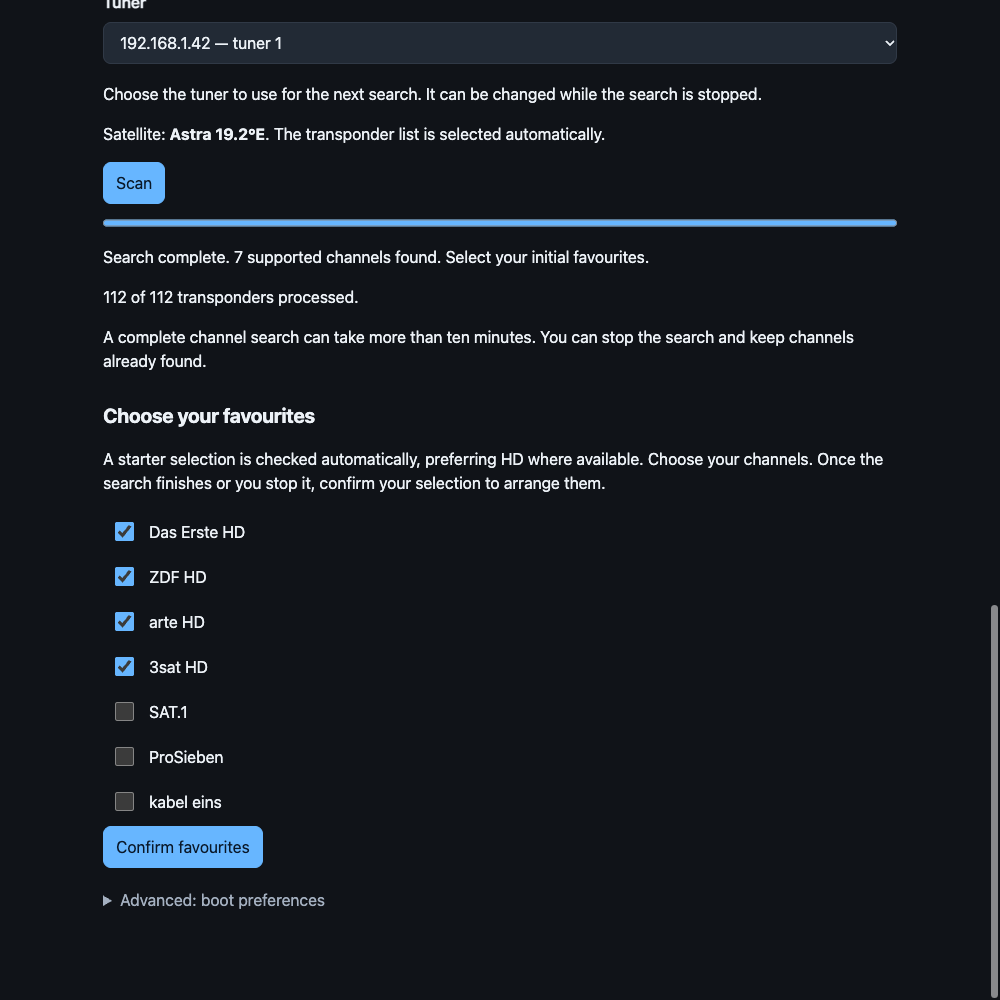

**Continue when:** The page shows Arrange your favourites. Channel selection and ordering are separate steps.

### 6. Arrange favourites and start watching

1. Drag channels into your preferred order. With a keyboard, focus a drag handle and use **Up/Down**.
2. Use **Change selection** if you need to add or remove channels; then confirm again.
3. Select **Save channels and watch TV**. The browser opens the normal receiver interface and HDMI television starts.

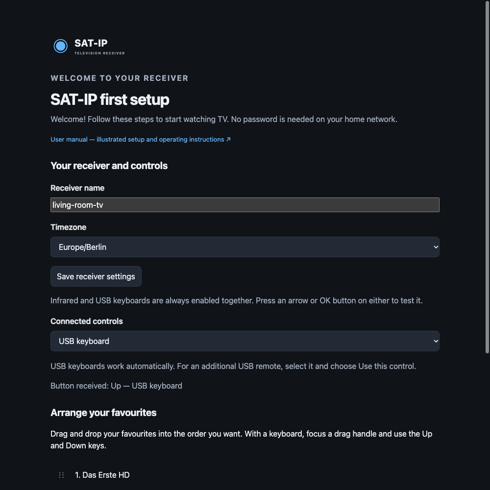

**Continue when:** There is a picture and audible sound, **Up/Down** changes favourite channels, and **Right/Left** changes volume. The first saved favourite is channel 1. Later changes go through Channels → Save favourites; you do not need to flash or repeat setup.

### 7. Set the receiver name, timezone and preferences

Open **Settings** to check your receiver name and timezone, choose the TV menu language and optionally set a web password. Follow [Changing settings](#changing-settings); if you saved name/timezone during setup, you do not need to save them again.

Finally, [download a configuration backup](#save-a-backup). **Setup is complete.** TV starts automatically after power-on, and your saved settings and channels survive restarts.

## Watching television

### Everyday controls

These controls apply to the keyboard or Apple Remote connected to the receiver, not to the computer running your browser.

| What you want to do | USB keyboard | Apple Remote A1294 |
|---|---|---|
| Next / previous favourite | Up / Down | Up / Down |
| Raise / lower volume | Right / Left | Right / Left while playing |
| Open favourites or choose highlighted channel | Enter | Centre |
| Show / close programme details | I | Menu |
| Move through an open list or scroll details | Up / Down | Up / Down |
| Close a panel without selecting | Esc | Menu; from favourites it opens details first, then closes |

For pause, resume and seeking, see [USB time shifting](#usb-time-shifting-pause-and-go-back).

Channel selection wraps from the last favourite to the first and vice versa. If you press several channel buttons quickly while tuning, the last selection wins, but an intermediate channel can appear briefly. Allow a few seconds for a picture after changing channel.

### Channel list and programme information

Press **Enter/Centre** for favourites. Use **Up/Down** to highlight a channel and **Enter/Centre** to watch it. The list opens on the page containing the current channel. Available current programme titles appear beside channel names.

Press **I/Menu** for programme details. Use **Up/Down** to scroll long descriptions; these buttons do not change channels while details are open. Press **I/Menu** again, or **Esc** on a keyboard, to close details. Video and sound continue behind these panels.

A bottom banner appears briefly when changing channel and shows the channel, available current/next programme information, local date/time and audio information. Programme information may need a minute or more to arrive. Some unvisited channels may have no information yet. Scheduled programme times are supplied by the broadcaster and may not reflect actual running times. During delayed TV, **Live programme information** describes the live schedule, not the older buffered programme.

### Picture and sound

Adjust both receiver volume and the TV/AV receiver's volume. Make sure the TV is not muted and has the correct HDMI input selected. German surround sound is used automatically when broadcast and the connected HDMI equipment supports multichannel PCM; otherwise sound is stereo. For surround, a direct connection to a compatible AV receiver may be necessary. A TV advertising only stereo PCM receives stereo even if it supports compressed Dolby audio.

After changing the HDMI cable or TV/AV receiver connection, reboot the Pi to recheck the display and sound capabilities. Browser sound is stereo and its volume is separate from HDMI volume.

## Using an infrared remote

An infrared remote needs **both** a supported remote and an IR receiver connected to the Pi. An ordinary Raspberry Pi 4 has no built-in IR sensor. A USB keyboard works without this hardware, and both control methods can be used together.

The supplied keymap is for the silver **Apple Remote A1294** with its separate Play/Pause button. It is not an Apple TV Siri/Bluetooth remote, and fitting a sensor does not automatically add support for arbitrary TV remotes. Point the remote at the IR sensor with a clear line of sight.

### Option A — Argon ONE V2 case

The project's reference case is the **Argon ONE V2 for Raspberry Pi 4**, which includes an infrared receiver. Fit the case and its daughterboard according to the case instructions so that the GPIO contacts are seated correctly and the IR window is unobstructed. The appliance image already enables IR reception on **GPIO23** and loads the supplied Apple Remote keymap; no separate Argon IR software is needed for receiver control. See [reference hardware](reference-setup.md) and the [Argon40 website](https://argon40.com/) for the case. Check the model: similarly named Argon cases are not automatically interchangeable.

Do not attach a second receiver to GPIO23 while the case receiver is connected. Two receiver outputs must not be wired together.

### Option B — a three-pin IR receiver

Use a **38 kHz demodulating IR receiver** that works at **3.3 V** and produces a 3.3 V-compatible digital output. A bare IR LED or phototransistor is not a substitute. A three-pin receiver/module normally labels its connections VCC/VS, GND and OUT/S; their physical order varies by part.

> **Disconnect all Pi power before wiring.** The GPIO inputs are not 5 V tolerant. Use the 3.3 V supply, never a 5 V header pin, and check the actual receiver's datasheet rather than guessing pin order. Avoid shorts between neighbouring pins.

| Receiver connection | Raspberry Pi 4 connection | Physical header pin |
|---|---|---|
| VCC / VS — power | 3.3 V | Pin 1 |
| GND — ground | Ground | Pin 6 |
| OUT / S — signal | GPIO23 | Pin 16 |

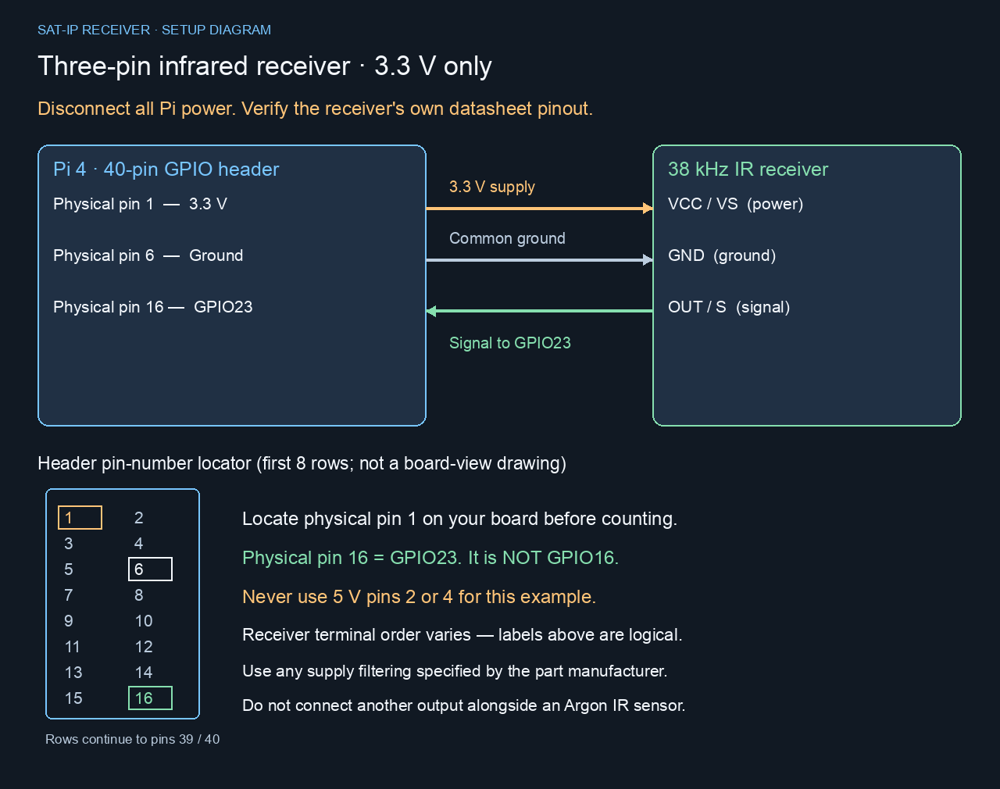

**Physical pin 16 is GPIO23, not GPIO16.** Physical numbers count positions on the 40-pin header; GPIO numbers name the software signals. Locate pin 1 from the board/header marking before counting. On a bare Pi 4 viewed component-side up with USB/Ethernet sockets on the right, the GPIO header runs along the upper edge: pin 1 is at the left end of the inner row nearest the board centre. Odd-numbered pins run along that inner row; even-numbered pins run along the outer row. The diagram labels pin positions, not a viewing direction for a particular receiver package.

1. Power off and unplug the Pi; disconnect other powered equipment that could feed it through accessories.
2. Identify VCC/VS, GND and OUT/S from the chosen receiver's datasheet. Use any supply-filter components specified there; a receiver module may already include them.
3. Connect the three leads as shown in the table. Keep wires short, insulated and securely seated. Leave the sensor's receiving face exposed.
4. Recheck supply voltage, pin numbers and polarity before reconnecting power.
5. Boot the appliance. During first setup, press an arrow or Centre button and check **Button received** in the browser. After setup, try opening favourites with Centre and changing channels with Up/Down.

No boot-file change is needed when you use GPIO23 with this appliance image. If a sensor uses another GPIO, it is not the wiring configuration described here.

### If the remote does not respond

Check batteries, line of sight, GPIO seating and the receiver's pinout first. Use a USB keyboard to complete setup while checking the IR path. Seeing Infrared receiver connected to GPIO in setup confirms the input device exists; **Button received** confirms a recognised button press.

The packaged Apple keymap covers the tested remote ID. Another A1294 may send a different ID and need one-time keymap learning. The [infrared guide](infrared.md#learn-another-apple-remote-id) gives the self-service procedure. Do not change live wiring or reset the channel setup to fix an IR problem.

## Using the browser interface

Open your bookmarked receiver address on a phone, tablet or computer on the same home network. If you enabled a web password, sign in with username **satip** and that password. If your router changes the address, check its connected-device list; the receiver's local name may still work.

The **User manual** link opens the illustrated guide in a new tab, without replacing the current receiver page. You can print it or save it as PDF using your browser's Print command. Its files are stored on the receiver, so reading it does not need an internet connection.

| Page | Use it for |
|---|---|
| Status | Check playback, reception, temperature and network health |
| Live TV | Watch television on this phone, tablet or computer |
| Channels | Find channels and save your favourite order |
| Channel search | Search for additional supported channels |
| Settings | Change network, access, display, storage and device settings |

### Status

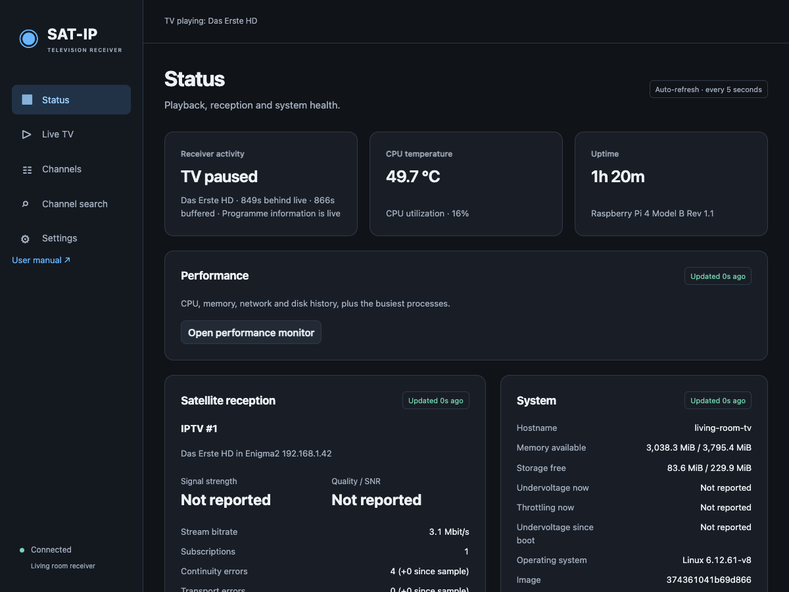

Status refreshes automatically. **Not reported** means the receiver has no measurement; it does not mean zero signal. An idle tuner is not the same as a failed tuner. With SAT-IP, signal strength and quality help identify reception problems, but there is no single universal good value for every server. Enigma2 arrives as a network stream, so satellite signal readings may be unavailable on the Pi; check reception on the source box instead.

In **Performance**, select **Open performance monitor** for CPU, memory, network and disk graphs. Wait for two samples (about five seconds) for rates. Close the window with **Close** or **Escape**. Opening it does not interrupt television. You normally do not need this window; use it to investigate repeated playback interruptions.

### Watch in a browser

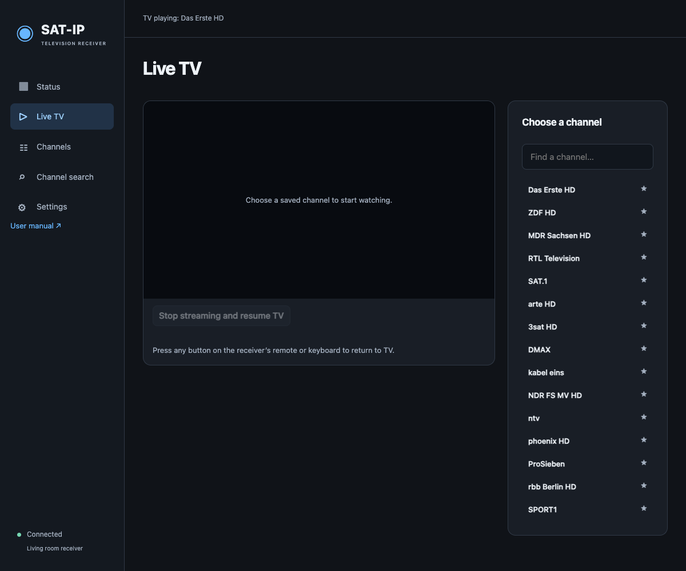

1. Open **Live TV** and choose a saved channel. Alternatively, select the **Watch live** icon beside a channel on **Channels**. For a newly found channel, add it to favourites and save first if it is not yet watchable.
2. HDMI television pauses while the browser stream runs. If the browser blocks automatic playback, press **Play** in the video player.
3. Use the player's volume and fullscreen controls. Browser viewing can lag live reception by several seconds.
4. Select **Stop streaming and resume TV** when finished.

Only one browser stream runs at a time. Searching and saving channels are blocked while streaming. Use **Stop streaming and resume TV** rather than simply closing the page; automatic return to HDMI may take about 20 seconds if the page closes unexpectedly.

**Someone using the receiver's physical keyboard or remote takes priority:** a button press stops browser viewing and returns television to HDMI. The browser explains the interruption. Start a new stream explicitly if you want to watch there again. Computer keyboard presses do not request this handover.

## Managing channels and favourites

### Add, remove and reorder

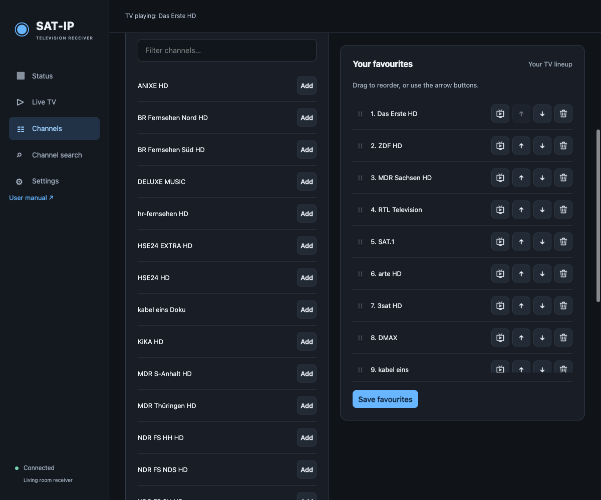

1. Open **Channels**. Filter available channels by name to find a station.
2. Add the station to **Your favourites**. Use its trash icon to remove it from favourites; this does not mean removing the station from the satellite.
3. Drag the handle to reorder, or use the arrow buttons. The first saved favourite is channel 1 in the TV list.
4. Select **Save favourites** and wait for successful feedback. At least one favourite is required.

> **Save before leaving:** Moving or adding channels in the browser is not enough. HDMI uses the last saved list until you select **Save favourites**. Unsaved edits can be lost when you reload or close the page.

Saving favourites does not normally interrupt HDMI viewing. If saving times out, check the page feedback before retrying: the receiver may have completed the save even though the response was lost.

### Search for channels

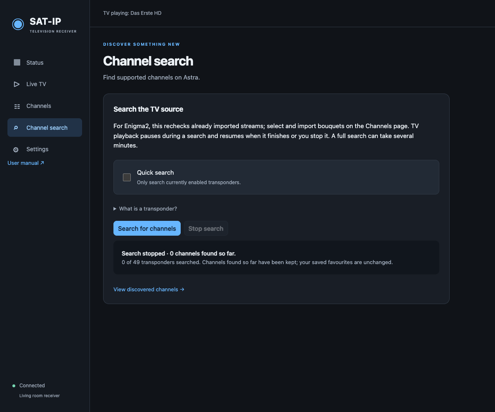

**With SAT-IP selected**, use this sequence:

1. Finish browser viewing, then open **Channel search**.
2. Leave **Quick search** unchecked for the full configured Astra search. Quick search checks only currently enabled groups of channels and can miss others.
3. Select **Search for channels** and confirm the viewing interruption.
4. Wait for completion, or select **Stop search** to keep results already found.
5. Open **Channels**, add newly found stations to favourites, and select **Save favourites**.

**With Enigma2 selected**, Channel search rechecks imported streams; it does not search Astra frequencies or fetch new bouquets. To add new bouquets, follow [step 4B](#4b-enigma2--select-a-box-and-import-bouquets), using Settings → TV source → Configure a source and Channels. The box needs free tuner capacity during checking/import.

The search does not change your saved favourites automatically. **Reload saved channels** reloads the saved list; it does not search for new channels.

If television does not resume and a recovery control is offered, select **Restore TV playback**. Wait for recovery rather than repeatedly starting searches or restarting the receiver.

### Switch TV source after setup

Open **Settings → TV source**. **Current TV source** shows the external device name/address, configured SAT-IP tuner and currently receiving input. “Unavailable” means the saved server is not currently available; an idle server is not shown as receiving TV. “Tuning, but no stream data received” means the selected tuner is not delivering TV data: check its satellite cable and signal. For Enigma2, the box allocates its physical tuner; the Pi cannot choose it.

To configure the alternative source, use **Configure a source**. SAT-IP shows only **Change tuner** for the existing server; its identity is already in Current TV source. Enigma2 offers **Find Enigma2 receivers**, with a receiver-selection list only after devices are found; choosing a result does not switch playback. For Enigma2, choose a receiver, select **Load Enigma2 TV bouquets**, then select/import bouquets on **Channels**. See [step 4](#4-choose-your-source-and-load-channels) for compatibility and channel-loading guidance. Replacing the configured SAT-IP server after setup is not supported here.

Once its channels are ready, choose **Activate SAT-IP source** or **Activate Enigma2 source**. The button is disabled if that source is already active or not yet configured, with an explanation. Changing a dropdown alone does not switch playback. Activation briefly restarts TV and reloads the page. Each source keeps its own channels and favourites.

To change only the SAT-IP tuner, activate SAT-IP, select a numbered tuner with a connected satellite cable on the configured server and choose **Apply SAT-IP tuner**. Confirm the brief playback/page restart; channels and favourites are retained, no channel scan runs, and the tuner choice survives restarts. With browser login enabled, confirm with your current web password. Finish scans, imports, browser viewing, Wi-Fi trials and maintenance first. The server must be available, and the selected tuner must support the same satellite position without linked/master-slave wiring. If a change fails, the previous configuration is restored or the page reports that recovery is needed.

## Changing settings

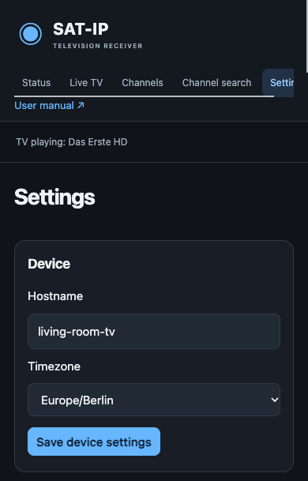

Settings are saved across reboots. Use the Save button belonging to the section you changed. Most settings do not need an image rebuild or file editing.

### Receiver name and timezone

Under **Device**, enter a **Hostname**, for example **living-room-tv**, using lower-case letters, numbers and hyphens, with no hyphen at either end. Select your local **Timezone**, for example Europe/Berlin, then **Save device settings**. Timezone controls the TV clock and programme times and applies immediately. Reboot to apply a hostname change. Reconnect using the numeric address from the TV/router if needed; the hardware-derived satip-….local address normally stays unchanged, but custom-name.local is not guaranteed to resolve.

### Change Wi-Fi safely

1. Keep Ethernet connected if possible, so you have another way to reach the receiver.
2. Under **Wi-Fi**, enable it and enter **Network name**, **Wi-Fi password** and your two-letter **Country code**. Use **Scan for networks** to select a network.
3. Select **Try Wi-Fi settings**. The connection and television may briefly pause.
4. Reconnect to the receiver if its address changed, then select **Keep settings** within **90 seconds of starting the trial**.

If you do not confirm in time, the previous settings return automatically. **Revert now** returns them immediately. To keep settings, Wi-Fi must actually be connected and have an address. Wi-Fi can be disabled only when Ethernet has a usable address.

A blank Wi-Fi password keeps the old password only if the network name is unchanged. The form supports automatic addressing (DHCP), not static addresses or enterprise/open networks. If the page disappears during a trial, allow rollback to finish before attempting another change.

### Passwords and access

New installations allow management without a login on the home network. Consider setting a web password if others share that network.

- **Change web password:** Set and confirm a password to enable browser login. The username is **satip**. Keep the password somewhere safe.
- **Change root password:** This is a separate maintenance/SSH password, not the password used to open the browser interface. Ordinary television operation does not require SSH.
- **Enable SSH:** Optional remote shell access for your own diagnostics. Enabling requires a saved root password or authorised SSH key. Leave it off if you do not need it.

When a protected receiver asks you to confirm maintenance or restore, use the **current web password**, not the root password and not a password contained in a backup. On a login-free receiver, no password is requested. Cancel or Escape closes a confirmation dialog without applying the action.

> **Use only a trusted home network.** Browser access uses HTTP, which does not encrypt passwords or backups. Do not forward the receiver's port through your router or expose it to the internet.

### On-screen language and banner duration

Under **TV on-screen display**, choose **English** or **Deutsch**, then **Save settings**. This changes TV menus and startup messages, not the language of broadcast titles/descriptions or audio. The browser interface and this manual are English.

Set **Bottom bar timeout (seconds)** to 0.5–30 seconds and save. This affects temporary channel and volume bars, not the favourites list or programme-details panel. Those remain open until you close them.

## Backups

Make a configuration backup after setup and after important changes. Keep it on your computer or another private storage location, not only on the receiver's SD card.

### Which backup should I use?

| Backup | Where to find it | What it restores |
|---|---|---|
| Channel backup | Channels → Channel backup; also SAT-IP first-time setup | Available channels and saved favourite order; SAT-IP restore also works after reflashing, keeping new device settings |
| Configuration backup | Settings → Configuration backup | Channels, favourites, supported device/network settings and access credentials; receiver reboots after restore |

Neither backup includes the operating-system image, recordings or time-shift history. The two file types are not interchangeable.

### Save a backup

1. Save any favourite edits. Finish channel searches, browser Live TV and Wi-Fi trials, and resolve any recovery warning.
2. On **Channels**, select **Download channel backup**, or on **Settings**, select **Download backup** for the full configuration.
3. Keep the page open while the receiver briefly pauses television and reconnects. Wait for the download to finish.
4. Store the dated `.tar` file safely. Do not unpack, edit or recompress it before restoring.

> **Full configuration backups are not encrypted and contain passwords and private access credentials.** Do not email them casually, publish them, or attach them to a public bug report.

### Restore a backup

1. Finish viewing/searches/trials as above. Select **Restore channel backup** or **Restore backup**, matching the file type. Maximum file size is **32 MiB**.
2. Select the trusted archive. Uploading validates it before any replacement. Review the date, channel counts where shown, and overwrite warning.
3. Confirm replacement using the **current web password** if requested. Cancel leaves the receiver unchanged.
4. For a channel backup, wait for the page to reconnect; channels and saved favourite order are replaced, not merged. The receiver does not reboot.
5. For a full configuration backup, wait for reboot, then reconnect using the **restored network settings and web password**. The address or hostname can change.

SAT-IP channel backups can restore your Astra 19.2°E lineup after reflashing or on another Pi, keeping the new receiver’s settings, passwords and tuner selection. In first-time setup, select the SAT-IP server and tuner and choose **Restore channel backup instead** to skip the full channel search. Review the backup date and counts and confirm; TV starts with the saved favourite order. Existing version-1 SAT-IP backups are supported by the updated importer. Enigma2 channel restore still requires the same configured channel network. Both backup kinds require a compatible backend version; check compatibility before changing image versions. Restoring USB settings never formats the drive. See [channel backup details](device-settings.md#channel-backup) and [configuration backup details](device-settings.md#configuration-backup).

## Optional features

Time shifting needs suitable USB storage; YouTube needs internet access and a linked phone or tablet.

### USB time shifting: pause and go back

Use a dedicated USB 3 SSD where possible. Time shifting temporarily keeps a limited amount of HDMI television; it is **not recording**. History is discarded on channel change, return to live, restart or switching to browser/YouTube viewing. Browser television does not use time shifting.

1. Connect a suitable USB drive. In **Settings → Time shift and USB storage**, select **Choose device**. Check model, capacity and device identity carefully.
2. Select **Use existing ext4 filesystem** for a compatible drive, or **Format & use device** to prepare one.
3. Set **Storage limit (GiB)** and select **Save storage limit**. The default is 8 GiB, or the capacity of a smaller drive. A smaller limit retains less television.

> **Formatting permanently erases the entire selected disk.** Never select a drive containing files you need. Cancel if you are unsure which drive is selected.

A drive needs at least 2 GiB free to mount; formatting requires a drive of at least 3 GiB. Buffering reserves roughly 1 GiB free space. Retained viewing time varies with channel bitrate and storage limit; a size limit is not a guaranteed number of minutes.

| While using time shift | Keyboard | Apple Remote |
|---|---|---|
| Pause / resume | Space, Pause or Play/Pause | Play/Pause |
| Back / forward about 30 seconds | Page Up / Page Down | Not assigned |
| Back / forward about 10 seconds while paused | Not assigned | Left / Right |
| Return to live with no navigation panel open | Home or Esc | Menu |

The lower TV bar shows your delay behind live and buffered position. While the remote is paused, Left/Right seeks; while playing, it adjusts volume. Repeated seek presses move farther, but seek accuracy depends on the broadcast. Without usable USB storage, Pause shows an unavailable notice and TV stays live.

Old content is removed when the buffer fills. If your paused position expires, it moves to retained content and stays paused. **Return to live** ends that buffer session. Before unplugging the drive, select **Safely remove USB** in Settings and wait for success. Do not unplug after a failed removal. **Forget USB configuration** clears the remembered drive after removal; it does not erase the drive.

### YouTube from a phone or tablet

1. Open **Settings → YouTube link** and select **Link with TV code**.
2. On your phone or tablet's YouTube app, open **Settings → Watch on TV → Enter TV code**; wording may vary by app version. Enter the receiver's code within five minutes.
3. Select a compatible public video. YouTube replaces HDMI television while it plays.
4. Choose **Disable YouTube / return to TV** on the receiver, or press a receiver channel/navigation button to return to television.

Only compatible public H.264/AAC videos up to 720p are supported. This is not a certified Chromecast/AirPlay receiver; some videos will not play and YouTube can change the service. If the QR shortcut opens help instead of pairing, enter the numeric code.

Keep pairing codes private. Linked phones can control the receiver even from another network. **Disable YouTube / return to TV** retains linked phones; **Forget linked phones** removes their pairing.

## Restarting and shutting down

In **Settings → Maintenance**:

- **Restart TV playback** restarts the HDMI player. Try this for a persistent playback problem after ruling out browser viewing or channel search.
- **Reboot** restarts the whole receiver. Wait for startup and television to return.
- **Shut down** stops the receiver safely. Wait for shutdown before disconnecting power. To start it again, disconnect and reconnect the power supply.

Finish searches, browser viewing, Wi-Fi trials and pending recovery before maintenance. If a confirmation asks for a password, enter the current web password. The Pi can remain electrically powered after shutdown; shutdown does not necessarily turn off the TV or extinguish every indicator. Avoid pulling power during scans, saves, backup/restore or USB operations.

## Troubleshooting

Start with the checks below. Do not format drives, reflash the SD card or change advanced files just because television stops.

| Problem | What to check or try |
|---|---|
| Nothing appears on the TV | Check TV power and HDMI input, cable connections and Pi power. After changing the HDMI connection, reboot. |
| TV shows a welcome screen instead of channels | Complete setup at the displayed address. The welcome screen is normal before channel setup is saved. |
| Browser address does not open | Use the exact address including http:// and :8080. Connect to the same non-guest home network. Try the numeric address or find it in your router. |
| Wi-Fi setup fails | Check country, network support, keyboard layout, Caps Lock and password. Move closer to the router or connect Ethernet. |
| Page disappears while changing Wi-Fi | Reconnect at the new address and confirm within 90 seconds; otherwise wait for automatic rollback and use the previous connection. |
| SAT-IP server is not found | Check its power, home-network connection and satellite installation. Search again. Check that guest-network isolation is off, or enter the server description URL as explained in first setup. |
| Search finds no channels | Check the satellite signal and that the selected tuner is available. Try another free tuner after the previous search/recovery finishes. |
| Picture is interrupted or freezes | Prefer Ethernet, check network/satellite stability, then view Status. If no search/stream is active, try Restart TV playback. |
| Picture but no sound | Check receiver volume, the TV's volume/mute and the HDMI connection. Only supported German main audio is used. Test another supported channel. |
| HDMI TV is paused | Stop browser streaming/search, close navigation panels if needed, or resume/return to live from time shift. Use offered playback recovery if required. |
| Up/Down scrolls rather than changing channels | A favourites/details panel is open. Close it with Esc or the relevant Menu/I action. |
| Remote does nothing | Check batteries, line of sight and the fitted compatible IR receiver. Try a USB keyboard. The ordinary TV remote over HDMI-CEC is not supported. |
| Favourite changes do not appear on TV | Select Save favourites and wait for success. Only the saved order is used. |
| Programme details are unavailable | Wait a minute or more after tuning. Broadcasters may not provide data, and channels not yet visited may have none. |
| Browser video will not start | Press Play if autoplay was blocked. Stop the old stream, allow cleanup, then start again. Try another supported saved channel. |
| Browser video stopped when someone used the remote | Expected: local receiver controls take priority. Start a new browser stream if desired. |
| Pause says unavailable | Configure suitable USB storage in Settings and check free space. Pause does not work as a permanent recording feature. |
| Time shift suddenly returns to live | Check the USB storage connection/free space in Settings. Do not format the disk to clear an error. Use the time-shift failure checks in the detailed Troubleshooting guide if it recurs. |
| Backup restore is refused | Use the correct trusted backup type, under 32 MiB, from a compatible installation. Cancel and review the backup compatibility requirements before retrying. |
| Old address or password fails after restore | Use the restored network/password settings; look for the receiver in your router's connected-device list. |

If you forgot the web password, use the password-recovery steps in [Further checks and recovery](#further-checks-and-recovery). Reflashing erases the installation and should not be the first response. If an action loses its browser response, check the receiver's state before repeating it.

## Further checks and recovery

For a recurring problem, note the channel, time, exact message and whether HDMI, browser viewing or both are affected. Check Status and the matching symptom in [Troubleshooting](troubleshooting.md). Advanced maintenance procedures are in the [Operations guide](operations.md). Never share passwords, pairing codes or full configuration backups publicly.

### If you forget the web password

The web password and root/SSH password are separate. If you still have root SSH/console access, you can set a new web password through the receiver's local device helper; see [password recovery](device-settings.md#recover-a-forgotten-web-password). If SSH is off or you forgot its password too, that guide explains how to enable recovery access through the flashed card's boot file without erasing channels/settings. Do not reflash the card merely to reset a password.

Technical references for advanced checks are available in the [documentation index](README.md). Developers can find image and hardware qualification limits in [Validation](validation.md).
